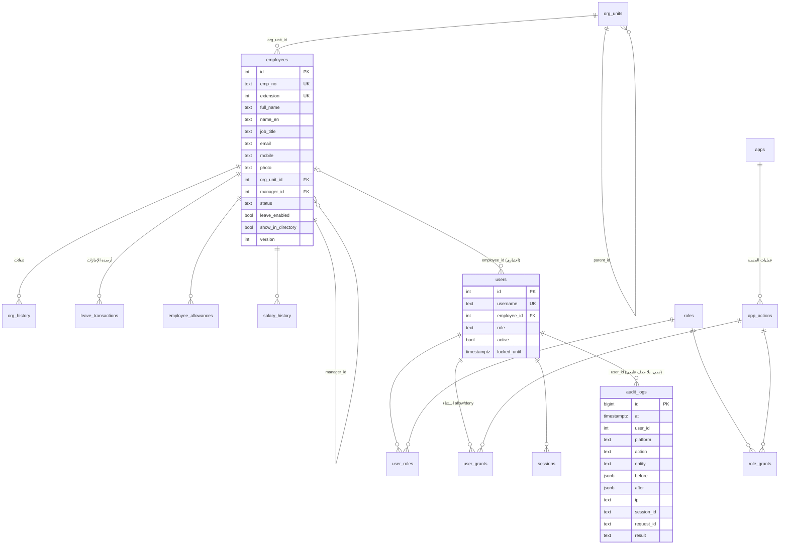

# البنية المعمارية للمنصة الموحّدة وقراراتها

هذا المستند يشرح ما بُني ولماذا، وما الذي نُقل وما الذي لم يُحذف بعد (ينتظر موافقتك).

## 1) الصورة العامة

```
المتصفح ──► Express (عملية Node واحدة)
             ├─ /               ← يحوّل إلى بوابة الموظفين (مفتوحة افتراضياً)
             ├─ /login/         ← تسجيل دخول واحد + بطاقات المنصات المتاحة للمستخدم
             ├─ /portal  /hr  /card  /report  /admin   ← المنصات (واجهات)
             └─ /api/*          ← واجهات الخادم؛ كل واحدة تفحص الصلاحية من قاعدة البيانات
                       │
        ┌──────────────┴───────────────┐
        │ طبقة الخدمات المشتركة (server/services)   employees · org · users
        │ مكتبات مركزية (server/lib)    rbac · audit · sessions · settings · reqctx
        └──────────────┬───────────────┘
                       ▼
                PostgreSQL واحدة (hadiyah)
```

- **لا مصادر متعددة للموظفين**: كل المنصات تقرأ وتكتب جدول `employees` عبر `services/employees.js`.
- **منطق الأعمال خارج الواجهات**: مسارات `routes/*` رفيعة، والقواعد في `services/*` و`lib/*`.
- لم تُضَف تقنيات جديدة: Express + pg كما كانا. الإضافة الوحيدة اعتماد تطوير `lucide-static` لتوليد ملف أيقونات ثابت (ISC) ولا يعمل وقت التشغيل.

## 2) مخطط العلاقات (ERD)



الجداول الأخرى (`link_categories/links`, `policy_categories/policies`, `locations`, `portal_docs`, `portal_backups`, `platform_settings`, `db_change_log`, `migration_conflicts`, `schema_migrations`) مستقلة وظيفياً.

## 3) القرارات المعمارية

| القرار | السبب |
|---|---|
| **`employees` هو السجل المركزي**، و`leave_enabled` يحدد من له ملف إجازات | نظام الإجازات يحتاج راتباً وتاريخ تعيين ورصيداً، ودليل البوابة لا يملكها. بدل جدولين متنافسين صار الجميع في جدول واحد، وقيد `employees_leave_profile_chk` يمنع ملف إجازات ناقصاً. محرك الإجازات لم يُعدَّل: يقرأ `WHERE leave_enabled` |
| **حساب الدخول منفصل عن الموظف**: `users.employee_id` اختياري | قد يوجد موظف بلا حساب أو حساب إداري بلا موظف |
| **الهيكل واحد**: `org_units` (منشأة ← قطاع ← إدارة ← قسم) + `employees.org_unit_id` + `unit_role` و`manager_id` | نقل الموظف مرة واحدة ينعكس في كل المنصات. المدير المباشر يُستنتج من رئيس الوحدة عند غياب `manager_id` |
| **التاريخ التنظيمي**: `org_history` لتنقلات الموظفين، و`db_change_log` (قبل/بعد) لتغييرات الوحدات، و`snapshot_rows` تحفظ وحدة كل موظف وقت اللقطة | التقارير السابقة لا تتغير دلالتها بنقل الموظفين لاحقاً |
| **RBAC بقاعدة البيانات**: `roles` + `role_grants(منصة، عملية، نطاق)` + `user_grants` (allow/deny) | الرفض افتراضي، ويغلب deny الدور، ويسري التغيير فوراً (ذاكرة مؤقتة 3 ثوانٍ تُبطَل عند التعديل) |
| **نطاق البيانات**: `self < reports < section < department < sector < all` | يُحسب في الخادم من الهيكل (`lib/rbac.js` + `lib/orggraph.js`) ويُطبَّق في استعلامات الإجازات والدليل والبطاقة |
| **جلسات في القاعدة** (`sessions`) والـJWT يحمل `sid` فقط | يمكن إنهاء أي جلسة إدارياً، وتعطيل الحساب أو تغيير كلمة مروره يُسقط جلساته فوراً، مع مهلة خمول وانتهاء مطلق وقفل بعد محاولات فاشلة |
| **التدقيق**: `audit_logs` للإضافة فقط (مشغّل يمنع UPDATE/DELETE/TRUNCATE) | حماية من التعديل عبر أي واجهة أو استعلام عادي؛ الحقول الحساسة (كلمات المرور، الرموز، الرواتب) تُحجب قبل التخزين |
| **الترحيلات** `server/db/migrations` مرقّمة وتسجَّل في `schema_migrations` وتعمل داخل معاملة | قابلة للتكرار، وتأخذ نسخة احتياطية قبل التطبيق، ولا تحذف شيئاً |
| **تحرير البوابة لا يحذف موظفاً** | حفظ دليل البوابة يُخفي من حُذف (`show_in_directory=false`) ولا يحذف سجله، فلا تضيع إجازاته. الحذف الفعلي من الإدارة المركزية فقط وبقيود |
| **التزامن المتفائل**: `employees.version` | تعديلان متزامنان بالإصدار نفسه: ينجح أحدهما ويُرفض الآخر (409) |

## 4) نظام الصلاحيات

- **المنصات** (`apps`) وعملياتها (`app_actions`): الوصول، العرض، الإضافة، التعديل، الحذف، الاعتماد، التصدير، إدارة المستخدمين، التقارير — وتُخصَّص لكل منصة (مثلاً الإجازات: `financials`, `leaves`, `targets`, `import`, `snapshots`…).
- **الأدوار الجاهزة** (قابلة للتعديل وإضافة غيرها): مدير النظام، الموارد البشرية، المالية، الإدارة العليا، مدير قطاع/إدارة/قسم، موظف، مدير محتوى البوابة، مدقق. صلاحياتها مطابقة لما كان قبل الدمج تماماً.
- **أمثلة الملف**: موارد بشرية تدخل الإجازات وتضيف وتعدّل دون صلاحية `org`؛ موظف عادي يرى الدليل وبطاقته فقط؛ المدقق يرى السجل دون أي تعديل.
- **الفرض في الخادم**: `requireGrant(app, action)` على كل مسار، و`requireApp(slug)` على واجهات الإجازات، و`gate()` على صفحات المنصات. كل رفض يُسجَّل `denied`.

## 5) سجل العمليات والعمليات المباشرة على القاعدة

- **على مستوى التطبيق** (`audit_logs`): الدخول الناجح والفاشل، الخروج، إضافة/تعديل/نقل/حذف/دمج الموظفين، الهيكل، المستخدمون والأدوار والصلاحيات، الإجازات، الاستيراد، التصدير (CSV والبطاقات)، ومحاولات الوصول المرفوضة. كل سجل فيه المستخدم والمنصة والعنوان ومعرّف الجلسة والطلب ونتيجة العملية.
- **على مستوى PostgreSQL** (`db_change_log`): مشغّلات على الجداول المهمة تسجّل كل INSERT/UPDATE/DELETE بصفّه القديم والجديد.
- **كيف نتعامل مع ما لا يمكن نسبته لمستخدم التطبيق؟** الاتصال بالقاعدة من التطبيق يحمل `application_name = hadiyah-platform`. أي تغيير بغير ذلك (psql، pgAdmin، سكربت) يُوسَم `direct = true` ويُسجَّل معه **مستخدم القاعدة وعنوان العميل واسم التطبيق**، ويظهر في لوحة الإدارة تحت «تغييرات قاعدة البيانات ← المباشرة» وفي عدّاد الأحداث الأمنية. لا يمكن نسبته لشخص بعينه إلا بالرجوع لحساب القاعدة المستخدم، لذلك يُنصح بحسابات قاعدة شخصية لمن يصل للقاعدة مباشرة.
- **حدود معروفة**: مدير PostgreSQL (superuser) يستطيع تعطيل المشغّلات؛ حماية ذلك خارج نطاق التطبيق (صلاحيات الخادم). يُنصح بنسخ احتياطية دورية خارج الخادم.

## 6) الترحيل من البنية السابقة

شغّل `npm start` (أو `npm run db:migrate`) فيحدث التالي تلقائياً:

1. **نسخة احتياطية** في `backups/` (`pg_dump` إن وُجد، وإلا لقطة JSON لكل الجداول).
2. **001**: إضافة أعمدة الهوية إلى `employees`، ونقل دليل البوابة (`people`) إليه: الموظف المربوط يُدمج، وغير المربوط يُنشأ بلا ملف إجازات. يُربط `users.employee_id`. التعارضات (اسم/مسمى/وحدة مختلفة) تُسجَّل في `migration_conflicts` ولا تُهمَل، وتُعرض في لوحة الإدارة.
3. **002**: المنصات والأدوار والصلاحيات والجلسات والإعدادات؛ كل مستخدم يحصل على دوره السابق بصلاحياته نفسها.
4. **003**: `audit_logs` (ينقل السجل القديم) و`db_change_log` والمشغّلات.

`npm run db:report` يطبع تقرير التكرارات والتعارضات (للقراءة فقط).

**الاستعادة**: `pg_restore --clean --if-exists --no-owner -d hadiyah backups/<الملف>.dump`.

### ما لم يُحذف (بانتظار موافقتك)
لم يُحذف أي جدول أو عمود قديم. يمكن حذفها بعد التحقق من الترحيل وموافقتك:
`people` (حل محلها `employees`)، `audit_log` (حلّ محلها `audit_logs`)، الأعمدة `apps.roles` و`users.person_id` و`employees.person_id`.

## 7) الاختبارات

`npm test` (يحتاج PostgreSQL؛ تُتخطى الاختبارات بلا قاعدة، وتُنشأ قاعدة مؤقتة لكل ملف عبر `PG_ADMIN_URL`):
- `rbac.test.js`: الرفض الافتراضي، منع تجاوز الصلاحيات من الخادم، الاستثناءات الفردية، النطاقات، تعطيل المنصات، الجلسات، القفل.
- `central.test.js`: انعكاس تعديل الموظف ونقله في البوابة والبطاقة والإجازات، التزامن، قيود السلامة، الدمج، التدقيق وعدم قابليته للتعديل، التغييرات المباشرة، التصدير.
- `migration.test.js`: الترحيل من بنية قديمة بلا فقدان بيانات وقابليته للتكرار.
- `platform.test.js` و`engine.test.js` و`targets.test.js`: بيانات البوابة ومحرك الإجازات.
